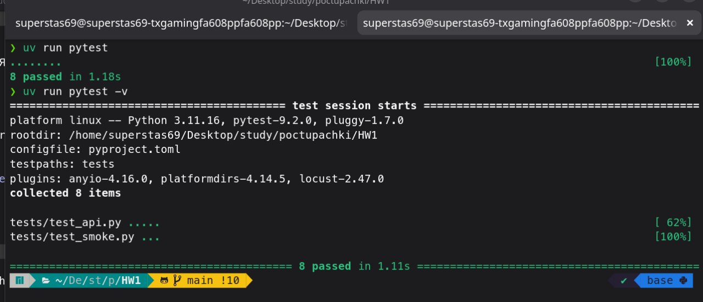
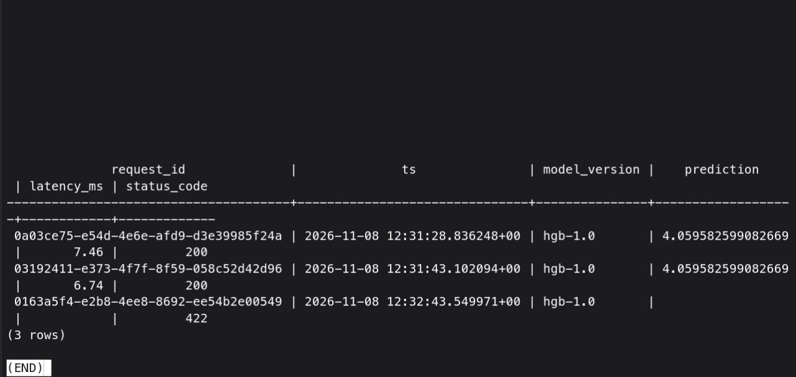
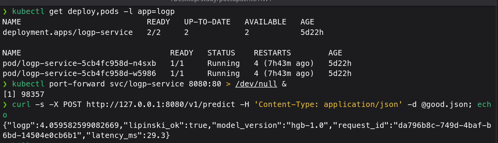
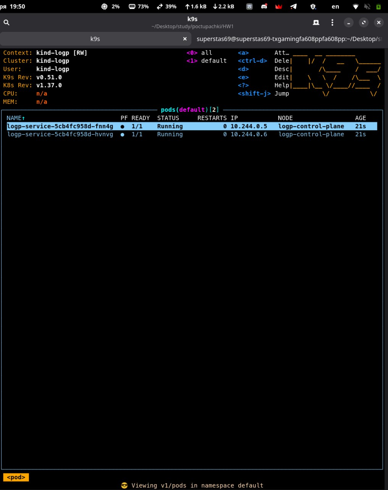

**Отчёт по ДЗ 1**  
**Чекпоинты базовой части**  
**pytest**: 8 тестов, все зелёные.  


**SELECT из таблицы логов** после `docker compose up`: в таблице видно и успешные запросы, и 422.  


**kind**: kubectl get deploy,pods с 2/2 Running и ответ `/v1/predict` через port-forward.  


**k9s** с подами сервиса.  


**Журнал проблем – тут тольок звездочки, можно не смотреть**  
**1. Нагрузка упёрлась в 46 RPS, а время самой модели выросло в 18 раз.**  
   
 Первый прогон locust: при 50 пользователях медиана 840 мс, при 100 пользователях 2 с, RPS не растёт.  
   
 Медиана `latency_ms` из таблицы логов (а это только сборка DataFrame и `predict`, без сети и очереди) была \~47 мс  
   
 в прогоне на 10 пользователей и \~850 мс в прогонах на 50 и 100. Значит, тормозит сама модель, а не очередь перед ней.  
   
 `threadpoolctl.threadpool_info()` в контейнере показал `libgomp` с `num_threads: 32`: `HistGradientBoostingRegressor`  
   
 на каждый `predict` поднимает OpenMP на все ядра машины, а uvicorn выполняет до 40 запросов параллельно в пуле потоков.  
   
 Получается 40 × 32 потоков на 32 ядра, и они мешают друг другу.  
   
 Починил: `ENV OMP_NUM_THREADS=1` в Dockerfile, параллелим запросами, а не внутри одного предсказания.  
   
 Заодно уменьшил модель: 300 деревьев с `learning_rate=0.1` вместо 600 с 0.05 дают тот же R² (0.879 против 0.880),  
   
 а одна строка предсказывается за 3 мс вместо 5,4. Итог: 146 RPS вместо 46, медиана при 10 пользователях 7 мс вместо 46.  
   
 Сырые CSV до исправления лежат в `docs/loadtest/before_omp/`.  
**2. Скрипт замера батча получал `HTTP Error 502: Bad Gateway`.**  
   
 На машине в окружении `http_proxy=http://127.0.0.1:2080`, а в `no_proxy` записано `127.0.0.1/8`.  
   
 `requests` (на нём locust) понимает CIDR и идёт напрямую, `urllib` нет: он отправил запрос в прокси, а тот ответил 502.  
   
 После обхода прокси всплыло второе: одна строка с клиента занимала 64 мс при 5,7 мс на сервере.  
   
 `http.client` отправляет заголовки и тело двумя пакетами, и связка Nagle + delayed ACK добавляет \~40 мс.  
   
 Перешёл на `httpx.Client(trust_env=False)` с keep-alive: 6,4 мс.  
**3. Предупреждение в выводе pytest.** Starlette пишет `Using httpx with starlette.testclient is deprecated`.  
   
 Фильтр `ignore::DeprecationWarning` не сработал: это `StarletteDeprecationWarning`, наследник `UserWarning`.  
   
 Отфильтровал по тексту сообщения в `pyproject.toml`; на работу `TestClient` это не влияет.  
**4. Не ошибки, но выглядят как ошибки.**  
   
 `docker build` пишет `DEPRECATED: The legacy builder is deprecated`: на этой машине нет плагина buildx, сборка  
   
 идёт классическим сборщиком и работает. `kubectl rollout undo` предупреждает про `last-applied-configuration`:  
   
 откат меняет деплоймент в обход `kubectl apply`, после отката образ снова 1.0, как в манифесте, так что  
   
 следующий `kubectl apply -f k8s/` ничего не сломает.  
**Звёздочка 1: нагрузочное тестирование**  
`locustfile.py`: пользователь с паузой 0,1–0,5 с, POST `/v1/predict` с весом 10 (ибупрофен с немного изменёнными  
   
 дескрипторами, чтобы запросы различались) и GET `/health` с весом 1. Нагрузка на compose-версию, команды как в задании,  
   
 CSV в `docs/loadtest/`. Латентность в таблице для `/v1/predict`, RPS суммарный.  
  
|  |  |  |  |  |  |  
| - | - | - | - | - | - |  
| **Пользователи** |  **RPS** |  **median, мс** |  **p95, мс** |  **max, мс** |  **Ошибки** |  
| 10 |  32,2 |  7 |  17 |  108 |  0 % |  
| 50 |  138,0 |  46 |  120 |  230 |  0 % |  
| 100 |  145,8 |  380 |  540 |  835 |  0 % |  
  
   
До исправления OpenMP (проблема 1), для сравнения:  
  
|  |  |  |  |  |  |  
| - | - | - | - | - | - |  
| **Пользователи** |  **RPS** |  **median, мс** |  **p95, мс** |  **max, мс** |  **Ошибки** |  
| 10 |  28,1 |  46 |  98 |  240 |  0 % |  
| 50 |  45,9 |  840 |  940 |  1184 |  0 % |  
| 100 |  45,5 |  2000 |  2200 |  2508 |  0 % |  
  
   
Выводы. При 10 пользователях сервис почти простаивает: они просят \~32 RPS, и все получают. При 50 пользователях спрос  
   
 (\~140 RPS) сравнялся с пропускной способностью, появилась очередь: медиана выросла с 7 до 46 мс, p95 оторвался до 120 мс.  
   
 От 50 к 100 пользователям RPS почти не вырос (138 → 146): сервис это один процесс uvicorn, и почти весь путь запроса  
   
 (pydantic, pandas, обход 300 деревьев) держит GIL. По `docker stats` под нагрузкой контейнер занимает 1,2–1,4 ядра  
   
 из 32, на запрос выходит \~7 мс, отсюда потолок \~145 RPS. Всё, что сверху, становится  
   
 ожиданием в очереди: по закону Литтла 100 / 146 − 0,3 с паузы ≈ 0,38 с, ровно медиана. Ошибок нет ни в одном прогоне:  
   
 запросы ждут, но не отваливаются. Дальше масштабироваться надо процессами (`uvicorn --workers N`) или репликами.  
**Звёздочка 2: батч-эндпоинт**  
`POST /v1/predict/batch`: `rows: list[Features]` от 1 до 1000, все строки собираются в один DataFrame,  
   
 модель вызывается один раз. Замер: `uv run python scripts/bench_batch.py`, медиана из 15 повторов на compose-версии  
   
 (результат в `docs/loadtest/batch.txt`).  
  
|  |  |  |  
| - | - | - |  
|   |  **latency_ms (сервис)** |  **wall, мс (клиент)** |  
| 1 строка |  4,83 |  6,42 |  
| 500 строк |  21,81 |  29,99 |  
  
   
500 строк дороже одной всего в 4,5 раза: \~44 мкс на строку против 4,8 мс на одиночный запрос. Почти всё время  
   
 одиночного запроса это фиксированная плата за вызов: сборка DataFrame, проверки sklearn в пайплайне и проход Python-кода  
   
 по 300 деревьям, а сам спуск строки по дереву в Cython занимает наносекунды, поэтому каждая следующая строка добавляет  
   
 лишь \~34 мкс.  
**Звёздочка 3: выкат новой версии и откат**  
Видимое отличие 1.1: поле `app_version` в `/health`. Версия задаётся при сборке (`ARG APP_VERSION` в Dockerfile),  
   
 код тот же.  
```  
docker build --build-arg APP_VERSION=1.1 -t logp-service:1.1 .  
 kind load docker-image logp-service:1.1 --name logp  
 kubectl set image deploy/logp-service api=logp-service:1.1  
 kubectl annotate deploy/logp-service kubernetes.io/change-cause="1.1: app_version в /health" --overwrite  
 kubectl rollout status deploy/logp-service  
 kubectl rollout undo deploy/logp-service  
 kubectl rollout history deploy/logp-service  
   
```  
```  
REVISION  CHANGE-CAUSE  
 2         1.1: app_version в /health  
 3         1.0: базовая версия  
   
```  
Чтобы проверить, что сервис не замолкал, внутри кластера работал под-пробник: 10 раз в секунду GET `/health`  
   
 через Service (через port-forward так не проверить: он привязан к одному поду и рвётся, когда этот под удаляют).  
```  
kubectl run probe --image=logp-service:1.0 --image-pull-policy=Never --restart=Never --command -- python -c "  
 import json, time, urllib.request  
 while True:  
     try:  
         with urllib.request.urlopen('http://logp-service/health', timeout=2) as r:  
             print(time.strftime('%H:%M:%S'), r.status, json.load(r)['app_version'], flush=True)  
     except Exception as e:  
         print(time.strftime('%H:%M:%S'), 'ERR', type(e).__name__, e, flush=True)  
     time.sleep(0.1)  
 "  
   
```  
За время выката и отката пробник получил около тысячи ответов, ни одной ошибки (`docs/rollout/probe.log`).  
   
 Во время выката поды менялись по одному (`docs/rollout/pods_watch.txt`): рядом с двумя старыми поднимался новый,  
   
 проходил readiness на `/ready`, и только после этого один старый уходил в Terminating; так дважды. Около пяти секунд  
   
 пробник получал вперемешку 1.0 и 1.1, потом только 1.1. Откат вернул прежний ReplicaSet с образом 1.0:  
   
 в истории он стал ревизией 3, а ревизия 1 исчезла, потому что это тот же шаблон пода.  
   
 Сервис не молчал, потому что `maxUnavailable: 0` не даёт убрать старый под, пока новый не готов, readiness-проба  
   
 не пускает трафик в под до загрузки модели, а `preStop: sleep 5` держит уходящий под живым, пока Service убирает его  
   
 из эндпоинтов.  
